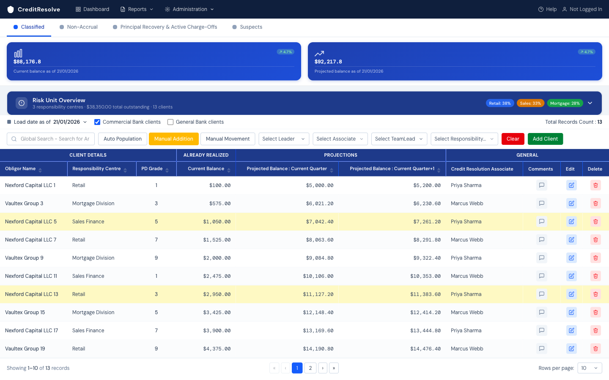
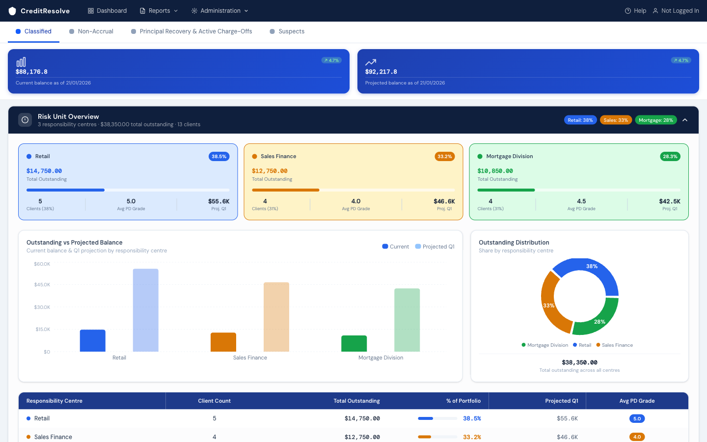

# CreditResolve

**A vibe-coded prototype** — built quickly through AI-assisted iteration to pressure-test a UI concept, not engineered as a production system. No backend, no persistence, no auth: everything here is mock data, and a page refresh resets it. Shared as a sample of fast, AI-assisted concept exploration in a real banking domain, not as a finished product.

**Live:** [creditapp-chi.vercel.app](https://creditapp-chi.vercel.app/)

## The idea

A dashboard for the team that manages a bank's **problem loans** — not origination, not performing-loan monitoring, but the workout/recovery side: loans that have already migrated into criticized or non-performing status and now need active management toward resolution.

The tab structure follows how banks actually bucket this work:

- **Classified** — loans carrying a formal risk rating (Special Mention, Substandard, etc.) requiring enhanced monitoring
- **Non-Accrual** — loans where interest income recognition has stopped because collection is doubtful
- **Principal Recovery & Active Charge-Offs** — loans already written down, now in collection/recovery
- **Suspects** — loans flagged for review but not yet formally classified



Each loan carries a PD (probability of default) grade, current and two quarters of projected balance, and an assigned credit resolution associate — the view a risk unit manager would actually want: who owns what, how much is at stake, and where it's trending.



The Risk Unit Overview rolls the same book up by responsibility centre (Retail / Sales Finance / Mortgage Division), with outstanding-vs-projected and concentration charts — the view one level up, for whoever owns the risk unit as a whole rather than individual names.

## What's real and what isn't

Real: the domain modeling (the tab taxonomy, the PD-grade + balance + projection shape, the responsibility-centre rollup) reflects how this work is actually structured at a bank. The interaction design — sortable/filterable tables, collapsible drill-downs, per-client comment history, add/edit/delete — is fully built and functional.

Not real: there's no backend. `src/lib/mockData.ts` is the entire data layer. Add/Edit/Delete and comments work against in-memory state for the session and vanish on reload. There's no multi-user concept behind "Priya Sharma" / "Marcus Webb" in the associate column — it's illustrative, not a real assignment system.

## Tech Stack

- Next.js 16 (App Router), TypeScript, Tailwind CSS v4, Recharts
- Deployed on Vercel

## Running it locally

```bash
npm install
npm run dev
```

Open [http://localhost:3000](http://localhost:3000).

## Related work

[CreditScout](https://github.com/arunr-mib/creditscout) is a separate, full-stack exploration in the same broad domain (commercial credit risk) — DSCR covenant monitoring rather than problem-loan workout, with a real backend, database, and an AI agent behind it. This repo is the lighter, UI-first sibling: what a concept looks like before it earns a backend.
